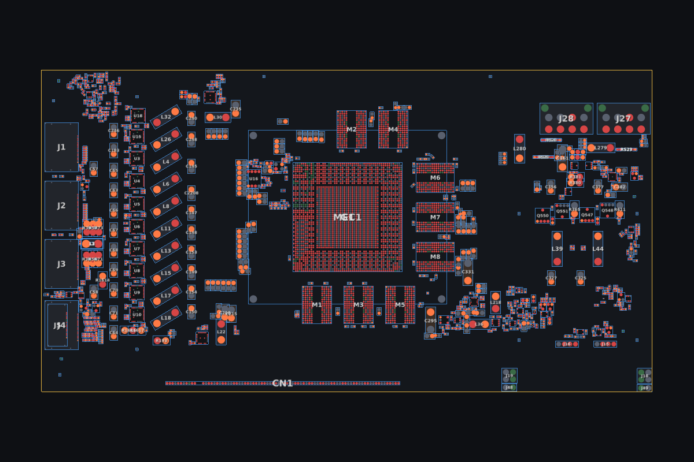
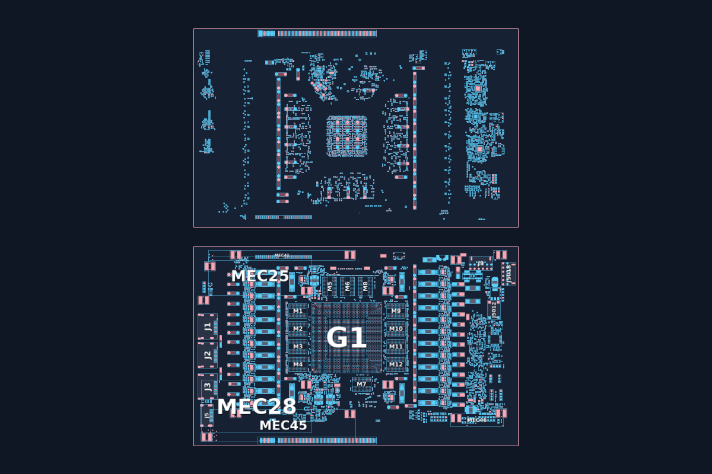
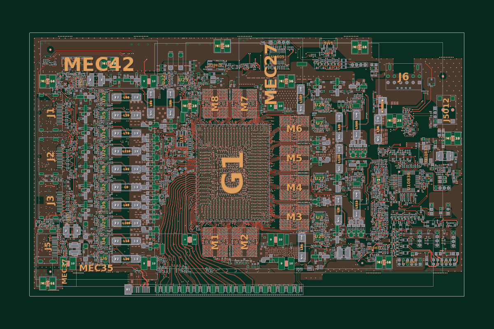
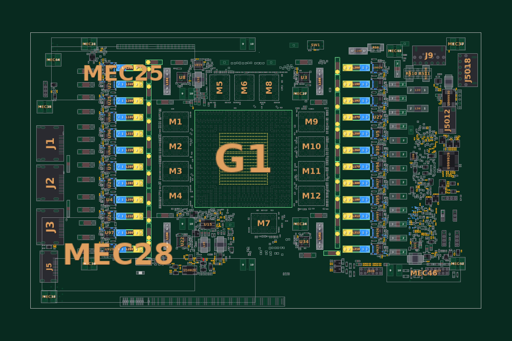
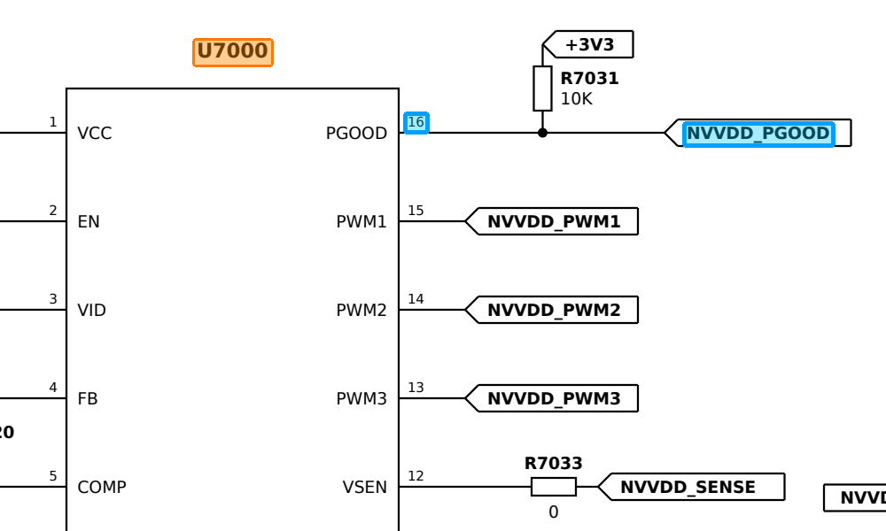

# GDTech BoardView

Visualizador de **boardview** gratuito e de código aberto, para quem conserta placas — placas de vídeo,
placas-mãe, notebooks. Abre os formatos mais comuns (.tvw, .fz, .brd, .bdv, .cad, .bvr, .cst, .pcb...),
mostra o **esquema em PDF** lado a lado e tem ferramentas de bancada: caçar curto, seguir a rede, notas,
comparar revisões e procurar a mesma peça em outras placas (sucata).

Criado por **GDTech Informática** — [YouTube](https://youtube.com/GDTechinformatica) ·
[Instagram](https://instagram.com/thegregin)

> *Free, open-source boardview viewer for Windows and Linux (UI in Brazilian Portuguese). Opens .tvw, .fz,
> .brd, .bdv, .cad, .bvr, .cst, .pcb and more, with a built-in PDF schematic viewer and repair tools.
> Downloads in [Releases](../../releases/latest).*



## Download

Pegue a versão mais nova em **[Releases](../../releases/latest)**:

| Arquivo | Para quem |
|---|---|
| `GDTech_BoardView_Setup_<versão>.exe` | **Windows 10/11** — instalador (atalhos e "Abrir com" dos boardviews). Não precisa de administrador. |
| `GDTech_BoardView_<versão>_portatil.exe` | Windows — roda direto, sem instalar |
| `GDTech_BoardView-<versão>-x86_64.AppImage` | **Linux** (Mint, Ubuntu, Debian, Fedora...) — veja abaixo |
| `GDTech_BoardView_<versão>.zip` | Windows e Linux — instala com um Python próprio (`INSTALAR.bat` / `INSTALAR_LINUX.sh`) e traz o **manual em PDF** |

**AppImage no Linux:** botão direito no arquivo → Propriedades → Permissões → marque *Permitir execução* e dê
dois cliques. Pelo terminal: `chmod +x GDTech_BoardView-*.AppImage && ./GDTech_BoardView-*.AppImage`.
Se não abrir, falta a biblioteca FUSE 2: `sudo apt install libfuse2t64` (Ubuntu 24.04 / Mint 22) ou
`sudo apt install libfuse2` (versões anteriores).

O **[manual completo](docs/Manual%20do%20GDTech%20BoardView.pdf)** (em PDF) explica tudo, passo a passo.

## O que ele faz

- **Rápido de verdade**: desenho pela placa de vídeo (OpenGL, com VSync), zoom e movimento suaves; cai sozinho
  para o modo CPU se o OpenGL não funcionar.
- **Pads de verdade**, nome da rede dentro do pino, caixa de informações ao passar o mouse (valor,
  encapsulamento, código do fabricante, pinos).
- **Busca** em duas caixas: **Part** (nome, coringa `C12*`, valor `0.47uF`, encapsulamento `0402`) e **Net**
  (vai até um pino da rede sem perder o lugar).
- **Vista dupla** (Top + Bottom espelhado, com as linhas da rede ligando as duas placas) e **modo camadas**
  (trilhas, planos e vias de cada camada em .tvw e GenCAD).
- **Esquema em PDF** nítido em qualquer zoom: duplo clique num componente ou **num pino** da placa leva até
  ele no esquema; botão direito no esquema → *Mostrar na placa*.
- **Ferramentas de conserto**: caçar curto (capacitores da rede em ordem, marcando os verificados), seguir a
  rede por resistores de 0 Ω/indutores/fusíveis, notas por componente (Trocado / Suspeito / OK), comparar
  duas revisões da placa.
- **Peça em outras placas (sucata)**: procura o mesmo componente (código do fabricante, ou valor +
  encapsulamento) em todos os boardviews e esquemas da sua biblioteca.
- Abas, tela de Início com recentes e biblioteca (acha o PDF de cada placa sozinho), temas com editor de
  cores, atalhos configuráveis (teclado e mouse), minimapa, peças mecânicas escondíveis.

| | |
|---|---|
|  |  |
| Vista dupla | Modo camadas |
|  |  |
| Ferramentas de conserto | Duplo clique num pino → o pino no esquema |

## Formatos suportados

| Extensão | Formato | Situação |
|---|---|---|
| .brd / .bv | Test_Link BRD (texto ou codificado), BRD2 (`BRDOUT:`) | ✅ |
| .bdv | Honhan BDV (codificado) | ✅ |
| .asc | format.asc + pins.asc + nails.asc na mesma pasta | ✅ |
| .bvr | BVRAW_FORMAT_1 e BVRAW_FORMAT_3 | ✅ |
| .cad | GenCAD 1.4 (inclusive variantes XY/TESTCAD) e CAD (`###Panel Added`) | ✅ |
| .cst | CST (binário IBM/Lenovo) | ✅ |
| .fz | FZ (RC6 + zlib) | ✅ |
| .cae | CAE | ✅ |
| .pcb | XZZPCB | ✅ |
| .faz .gr .f2b | — | abre se o conteúdo for de um dos formatos acima; senão avisa |
| .tvw | Tebo-ICT (Landrex) — formato decifrado por engenharia reversa | ✅ |
| .a3p .nbv | proprietários | ainda não suportados (mensagem clara ao abrir) |

A detecção é pelo **conteúdo** do arquivo, não pela extensão.
As chaves padrão já vêm no programa; **Arquivo → Chaves de descriptografia** só é necessário para arquivos com outra chave.

Os arquivos são reconhecidos pelo **conteúdo**, não pela extensão. Arquivos FZ/CAE com uma chave diferente da
padrão: **Arquivo → Chaves de descriptografia**.

## Atalhos principais

| Tecla | Ação |
|---|---|
| Roda do mouse | zoom no cursor |
| Arrastar | mover a placa |
| Clique | seleciona pino / componente |
| Duplo clique no pino | destaca a rede e vai até aquele pino no esquema (sem mexer no zoom) |
| Duplo clique no componente | mostra o componente no esquema (sem mexer no zoom) |
| Espaço | virar lado (Top/Bottom) |
| R / Shift+R | girar 90° |
| F | ajustar à tela |
| + / - | zoom |
| N | liga/desliga as linhas da rede selecionada |
| I | liga/desliga a caixa de informações ao passar o mouse |
| F2 | vista dupla (o outro lado espelhado logo acima, preso à placa) |
| Ctrl+N | vista dupla: linhas da rede ligando as duas placas |
| F3 | modo camadas |
| PgUp / PgDn | camadas: mostrar a anterior / a próxima |
| F4 | esquema elétrico (PDF) |
| Ctrl+W / Ctrl+Tab | fechar aba / próxima aba |
| F6 | painel de ferramentas |
| F7 / F8 | minimapa / pinos soltos e componentes sem rede |
| Tab / Shift+Tab | próximo / anterior pino da rede selecionada |
| Ctrl+T | ir para a aba Início |
| Ctrl+K / Ctrl+L | caçar curto na rede selecionada / seguir a rede |
| Ctrl+Shift+P | procurar a peça selecionada em outras placas (sucata) |
| ] / [ / V | caçar curto: próximo / anterior / verificado + próximo |
| Botão direito | notas, datasheet, caçar curto, copiar |
| Ctrl+F | buscar componente (caixa Part) |
| Ctrl+Shift+F | buscar rede (caixa Net) |
| Shift+M | mostrar/esconder peças mecânicas (reforço, furos, suportes) |
| Esc | limpar seleção |

Todos os atalhos podem ser trocados em **Ferramentas → Atalhos de teclado e mouse**.

## Rodar pelo código

Precisa do Python 3.10 ou mais novo.

```bash
git clone <este repositório>
cd <pasta>
# Windows
run.bat
# Linux / macOS
./run.sh
```

O `run.sh` cria um ambiente (`.venv`) e instala as bibliotecas de `requirements.txt` na primeira vez.

## Gerar os arquivos de instalação

| O quê | Como |
|---|---|
| `.exe` (Windows) | `build_exe.bat` → `dist/GDTech_BoardView.exe` |
| Instalador (Windows) | `build_installer.bat` (precisa do [Inno Setup 6](https://jrsoftware.org/isdl.php)) → `installer/Output/` |
| `.AppImage` (Linux) | `pip install -r requirements.txt pyinstaller`, `python tools/build_exe.py`, `tools/build_appimage.sh` → `builds/` |
| `.zip` com os instaladores | `python tools/build_release.py` → `builds/` |

**Release automático:** mude `APP_VERSION` em `gdboard/main.py`, envie para o GitHub e rode
**Actions → Release → Run workflow** (ou envie uma tag `v<versão>`). O GitHub Actions gera o instalador, o
.exe portátil, o .AppImage e o .zip e publica tudo em Releases. Os testes (`python -m pytest tests`) rodam a
cada envio.

## Estrutura

```
gdtech_boardview.py        ponto de entrada
gdboard/main.py            janela, menus, listas, busca, painel de informações
gdboard/parsers.py         leitores de formato (portados do OpenBoardView, MIT) + TVW
gdboard/board.py           modelo da placa (pinos, redes, pads, contornos)
gdboard/core.py            câmera, animação, seleção e mouse (comum aos dois renderizadores)
gdboard/glview.py          desenho pela GPU (OpenGL)
gdboard/view.py            desenho por CPU (QPainter), reserva se o OpenGL falhar
gdboard/layers.py          camadas de cobre (modo camadas)
gdboard/pdfview_pdfium.py  visualizador do esquema (pdfium): ladrilhos nítidos, texto, busca, pino no esquema
gdboard/pdfengine.py       motor do PDF em segundo plano
gdboard/tools.py           busca por valor/encapsulamento, caçar curto, seguir a rede, comparar revisões
gdboard/toolpanel.py       painel Ferramentas
gdboard/donor*.py          peça em outras placas (índice SQLite num processo separado)
gdboard/home.py, library.py  tela de Início, biblioteca, miniaturas
gdboard/notes.py           notas e verificados por placa
gdboard/theme.py, keys.py  temas e atalhos
gdboard/instance.py        "uma janela só" (abrir arquivo com o programa aberto → nova aba)
gdboard/about.py           janela Sobre
instalador/                INSTALAR.bat / INSTALAR_LINUX.sh e os scripts deles
installer/                 instalador do Windows (Inno Setup)
packaging/linux/           arquivos do AppImage
tools/                     scripts de build e release
tests/                     testes e arquivos de exemplo (gerados por tests/make_samples.py)
docs/                      manual em PDF e imagens
```

## Contribuindo

Sugestões, problemas e correções são bem-vindos em **Issues** e **Pull requests**. Se um boardview não abrir
direito, diga o modelo da placa e o formato do arquivo (não anexe arquivos de fabricante em issues públicas
se não puder compartilhá-los). Antes de enviar código: `python -m pytest tests`.

## Licença e créditos

[MIT](LICENSE) — use, modifique e distribua à vontade, mantendo o aviso de licença.

Os leitores de formato foram portados do [OpenBoardView](https://github.com/OpenBoardView/OpenBoardView) (MIT).
Créditos completos e licenças das bibliotecas usadas (Qt/PySide6, pdfium, NumPy...) em
[THIRD_PARTY.md](THIRD_PARTY.md).

Este programa não tem relação com nenhum fabricante de placas; os nomes de formatos e marcas citados são dos
seus donos.
